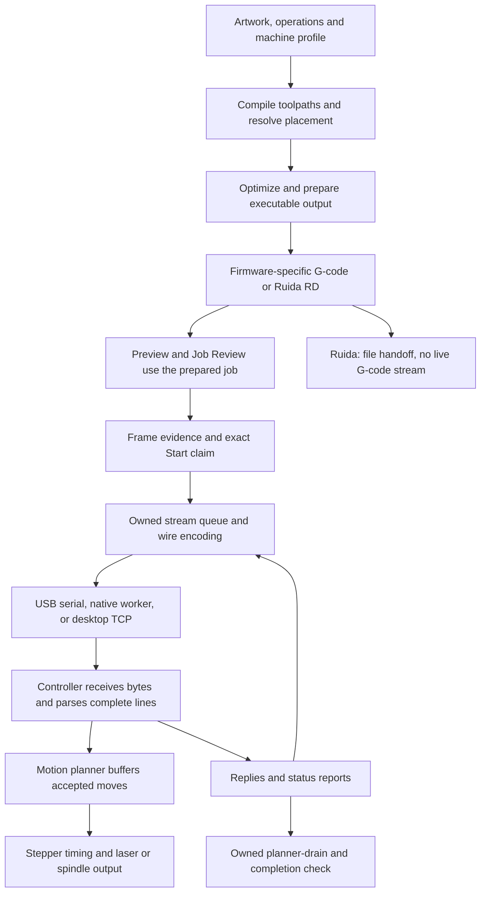

# G-code and controller pipeline audit — 16 October 2026

Baseline: `f7e2a36895b67cfa33be03c16e6c19e7c6722d14` (fetched `origin/main`).
Repair branch: `codex/controller-protocol-audit-fixes-20261016`.
Scope: all six supported controller families, their output dialects, serial/network transport,
acknowledgement accounting, stopping, reconnecting and completion. Creality Falcon command
extensions were checked as a profile specialization, not assumed to identify a particular firmware.

## Assessment

Four defects were independently reproduced in the baseline. The most serious allow an Abort
to continue feeding a Marlin job, or let a response be attributed to the wrong command.
The four defects are repaired on the isolated branch with production regression tests.
The verification section distinguishes baseline results from repaired results and records the
TypeScript library-context limitation. These changes are not yet merged or released.

The ordinary pipeline has substantial correct behavior: bounded send queues, firmware-specific
output, current-session ownership, no replay after uncertain writes, and a separate physical
completion transaction. This is not a certification that every machine or firmware build works.
No hardware was operated, no air-cut or material test was performed, and no desktop package was
built or released for this audit.

## How a job reaches the machine



KerfDesk generates command text; the controller runs firmware that interprets those commands.
For example, `G21` selects millimetres, `G90` selects absolute coordinates, and a `G1` move
carries its destination/feed and, where supported, laser power. The firmware applies its modal
state, validates the command, plans acceleration and creates the electrical output.
The host cannot infer real motor position or delivered optical power from a successful write.

An `ok` generally releases the sender's pending command, while accepted motion may still
remain in the controller planner. Final job acceptance therefore starts a separate settlement:
Marlin/Smoothieware use `M400`; the GRBL family uses an owned dwell marker and fresh Idle evidence.
Marlin's default `M114` projected position alone is not completion proof.
[GRBL interface](https://github.com/gnea/grbl/wiki/Grbl-v1.1-Interface),
[Marlin M400](https://marlinfw.org/docs/gcode/M400.html),
[Marlin M114](https://marlinfw.org/docs/gcode/M114.html).

Key implementation paths:

| Stage | Source |
| --- | --- |
| Shared preparation for output consumers | `src/io/gcode/prepare-output.ts` |
| Dialect selection and emission | `src/core/output/select-output-strategy.ts`, `src/io/gcode/emit-gcode.ts` |
| Exact Start authorization | `src/ui/state/laser-job-actions.ts` |
| Pure queue and pump | `src/core/controllers/grbl/streamer.ts`, `stream-pump.ts` |
| Controller-specific stream mode | `src/core/devices/controller-streaming-mode.ts` |
| Wire byte rules | `src/core/controllers/serial-wire-encoding.ts` |
| Serial ownership and reads | `src/platform/web/web-serial.ts`, `serial-worker-core.ts` |
| Reply ownership | `src/ui/state/laser-stream-ack.ts`, `laser-untracked-ack-ledger.ts` |
| Completion | `src/ui/state/laser-post-job-settle.ts` |

## Confirmed baseline defects

### F1 — P1: Marlin Abort can refill the job while stop writes await

Baseline locations: `laser-job-stop.ts:107,301-302`,
`laser-job-stop-outcome.ts:63-68`, `laser-stream-ack.ts:137-141`
(all under `src/ui/state/`).

Abort awaits its stop writes before cancelling the streamer. In a ping-pong stream, hold the
first `M107` write pending and deliver the preceding job move's `ok`. The still-active
streamer sends a new cutting move. Observed order:

```text
M107
G1 X2 S100
M410
M5 I
```

The reproduction used the production stop action, safe writer, line handler and streamer.
This proves additional job bytes can be sent after Abort begins; it does not measure real
stop latency or beam output.

Required repair: freeze refill before any Abort await, preserve the old in-flight reply debt,
and retain the stop operation's ownership until its cleanup is settled. Snapshot air-off needs
before clearing the queued program.

Marlin quick-stop behavior also depends on firmware configuration and processing state; the
software must not promise a universal physical stop deadline.
[Marlin M410](https://marlinfw.org/docs/gcode/M410.html).

### F2 — P1: Marlin Error plus following ok consumes two reply owners

Baseline locations: `src/core/controllers/marlin/response.ts:34,51-54`,
`src/ui/state/laser-error-line.ts:74`,
`src/core/controllers/grbl/streamer.ts:285-300`,
`src/ui/state/laser-stream-ack.ts:66,80-84`.

The shared response ledger treats a Marlin `Error:` as a complete response, as it does GRBL's
`error:N`. A Marlin command handler can print an error and then return to dispatch, which sends
the ordinary `ok` for that same command. The second message must not acknowledge cleanup.

The audit injected `Error:G2/G3 bad parameters` into the real line handler with one job command
outstanding. Cleanup queued `M107`, `M410` and `M5 I`. Delivering only the rejected command's
trailing `ok` reduced pending cleanup acknowledgements from three to two, although no cleanup
command had replied. This shifts the response queue one command early.

The invalid-arc example is a firmware-response reproduction, not a claim that normal generated
Marlin jobs contain invalid arcs: current generated laser output uses linear moves. The same
reply semantics matter for Console and other command-handler errors.
[Marlin 2.1.2.8 arc handler](https://github.com/MarlinFirmware/Marlin/blob/2.1.2.8/Marlin/src/gcode/motion/G2_G3.cpp#L447-L449),
[dispatch acknowledgement](https://github.com/MarlinFirmware/Marlin/blob/2.1.2.8/Marlin/src/gcode/gcode.cpp#L1016-L1018).

Required repair: stop new motion immediately, but retain the refused command's reply ownership
until its actual terminal reply. Keep kill/reset, resend and unknown-command semantics distinct.

### F3 — P1: recovered serial input can turn a damaged response tail into ok

Baseline locations: `src/platform/web/serial-read-loop.ts:85`,
`src/platform/web/serial-worker-core.ts:289-295,318`.

Both readers discard the partial prefix after a recoverable UART error but treat the next
stream's first bytes as a new complete record. Send `>G54G20:`, raise `FramingError`, then
deliver `ok\r\n` through the replacement readable. The main reader emits a standalone `ok`.
An armed worker consumes it and sends `G1 X2.000\n`.

The GRBL startup response deliberately embeds its `:ok` within a larger line; it is not a
separate acknowledgement of the running stream. The concrete reproduction proves the framing
fault and false refill; it is not evidence that a particular physical UART produced that sequence.

Required repair: discard the uncertain tail through the next line delimiter before resuming
record parsing. Preserve the writable Stop path. Never invent or replay a lost acknowledgement.
[GRBL interface](https://github.com/gnea/grbl/wiki/Grbl-v1.1-Interface),
[Web Serial specification](https://serial.spec.whatwg.org/).

### F4 — P2: bounded writer shutdown can still wait forever

Baseline location: `src/platform/web/bounded-writer-close.ts:55`;
window-owned close callers include `web-serial.ts:343`.

After its close deadline, the helper awaits `writer.abort()` with no further bound.
A real WHATWG WritableStream whose underlying close/drain remains pending also leaves abort
pending. With a 10 ms helper deadline, the reproduction remained unresolved and locked at
100 ms. Only completing the original drain released it; the underlying abort hook never ran.

This can leave window-owned Disconnect/Forget/reconnect waiting indefinitely. Native-worker
ownership already has an outer termination deadline, reducing its exposure.

Required repair: bound caller-facing shutdown while preserving truthful ownership of any
unfinished stream/port cleanup. A timeout must not silently create another writer for the same
still-closing port.
[Writable stream erroring](https://streams.spec.whatwg.org/#writable-stream-start-erroring),
[Chromium serial sink](https://raw.githubusercontent.com/chromium/chromium/main/third_party/blink/renderer/modules/serial/serial_port_underlying_sink.cc).

## Repairs in this branch

| Finding | Implemented repair | Retained regression |
| --- | --- | --- |
| F1 | Cancel host refill before the first await; keep the Abort operation and in-flight reply ownership; capture M9 needs before retiring queued work. | `src/ui/state/laser-job-stop-write-race.test.ts`: delayed stop writes, old replies, fresh Idle, hosted handback. |
| F2 | Mark non-halting Marlin errors as nonterminal reports; peek rather than consume the reply owner; reject owned commands after their trailing terminal reply. Preserve already-cancelled/error states. | `src/ui/state/laser-marlin-error-ack-ownership.test.ts`: job/Console/owned commands, early replies, resend, kill and late errors after Abort. |
| F3 | Start recovered readers in discard-through-LF mode. Both window and worker paths retain the usable Stop writer. | `web-serial-line-errors.test.ts` and `serial-worker-core.test.ts` under `src/platform/web/`: damaged suffix cannot dispatch/refill. |
| F4 | Bound close and abort; retain actual cleanup separately from each caller's wait; register full window/worker teardown ownership before callbacks can reopen the port. Failed/timed-out close cannot report successful Forget. | `bounded-writer-close.test.ts`, `web-serial-bounded-close.test.ts`, `worker-serial-bounded-close.test.ts`: real streams, stalled cancellation/drain/close, same-port retry, late release and Forget. |

The worker review found and corrected an additional edge within F4: its caller previously
swallowed a native-close timeout and could revoke permission while cleanup remained pending.
Both transport paths now give callers a bounded result without losing the actual cleanup owner.
No generated cutting path, power setting, machine setting, Frame policy or licence policy changed.

## Equal coverage of supported families

| Family | Reviewed output and sending contract | Remaining qualification boundary |
| --- | --- | --- |
| GRBL v1.1 | Modal preamble; M3/M4 laser behavior; CNC spindle/coolant/tool changes; arcs; character-counted queue including newline bytes; conservative default 120-byte host window; owned completion | Exact build, USB adapter, settings, machine wiring and physical output need a reproducible device qualification. Shared serial findings F3/F4 apply to applicable transports. |
| grblHAL | GRBL-family dialect with capability/status differences, independently observed capacities and parser limits; Falcon command extension tests included | GRBL syntax does not prove a stock GRBL buffer size, firmware identity or physical compatibility. Shared serial findings apply. |
| FluidNC | Forced one-line-at-a-time acknowledgement; executable line limits; read-only settings contract; serial and desktop TCP/Telnet transport | Real network loss, radio conditions, firmware configuration and background behavior remain device/runtime qualification. |
| Marlin | Forced ping-pong; explicit inline M3 I/M5 I boundaries or fan M106/M107; independent travel-feed handling; queued status, M400 settle and controller-specific Abort | F1/F2 plus applicable shared transport findings. Laser feature/build options, power units, emergency parsing and wiring remain configuration-sensitive. |
| Smoothieware | Forced ping-pong; fractional S; native M221 modes; M400 boundaries; manual fire-off; halt/unlock lifecycle | Dark G1 S0 requires minimum power zero. Recommended S maximum is 1.0 because of firmware fixed-point representation. Existing setup guidance already discloses these conditions. |
| Ruida | Experimental vector .rd export, encoder/decoder/golden checks; explicit refusal of unsupported raster/CNC output | File-only: no live G-code sender. Internal/golden validation is not proof a real Ruida accepts or executes the file. |

FluidNC's pinned 4.0.3 serial implementation explicitly requires waiting for each response;
this is already enforced in current KerfDesk.
[FluidNC serial contract](https://github.com/bdring/FluidNC/blob/v4.0.3/FluidNC/src/Serial.cpp#L17-L27).

Smoothieware settings affect power independently of the sender. The native Laser module applies
its configured minimum and maximum power; a module-presence response does not prove the
electrical output or every setting.
[Smoothieware Laser module](https://raw.githubusercontent.com/Smoothieware/Smoothieware/edge/src/modules/tools/laser/Laser.cpp).

Ruida's manufacturer documents its own controller/file workflow; this audit found no manufacturer
protocol acceptance evidence for KerfDesk's experimental encoder.
[Ruida RDC6445G](https://www.rdacs.com/en/product-detail/rdc6445g.html).

## Correct behavior retained

- Preparation resolves placement and produces the reviewed executable artifact. Start repeats
  authorization for the current owner immediately before installing the stream.
- Frame remains the ordinary Start policy gate for the unchanged footprint/placement; this audit
  does not add licence, account or controller-setting policy gates.
- GRBL queue accounting includes line terminators; parser-line limits and receive-window limits
  are separate checks. Realtime commands do not pretend to be normal acknowledged lines.
- Worker handoff preserves one refill owner. Epochs reject stale connection/run callbacks;
  disconnected streams are retained as evidence rather than advanced by a replacement session.
- Terminal errors do not turn into successful completion when later replies arrive.
- Laser/CNC preambles establish their needed modes, and relevant tool changes restore modal state.
- Current FluidNC ping-pong, Marlin inline transitions and Smoothieware native power modes already
  address older historical findings. They were rechecked rather than repeated as open bugs.
- Desktop TCP uses its own transport ownership and lease, not a promised browser-worker
  background guarantee. No WebSocket transport was assumed.
- Imported external G-code is visualization-only. Raw start helpers accept some control characters,
  but no ordinary exposed import execution route was established; this is defensive hardening,
  not a confirmed imported-file execution defect.

## Verification

Baseline targeted checks completed on the audited SHA:

| Cohort | Result |
| --- | --- |
| Output dialects, CNC modal/coolant, arcs, feed boundaries and Ruida | 157 tests passed in 20 files |
| All-family drivers and Falcon commands | 76 tests passed in 8 files |
| Stream/pump, byte windows, parser limits and classifiers | 140 tests passed in 13 files |
| Serial/worker/native/network transport | 160 tests passed in 12 files |
| Start/Frame claims, reply ownership, reconnect, completion, pause/Abort and simulators | 94 tests passed in 13 files |

These are cohort counts, not a deduplicated grand total. Diagnostic repeats are not added.
Two expected-safe audit assertions failed, proving F1/F2. F3 was reproduced by assertions
expecting the faulty output, and F4 by a real WritableStream delayed-drain script.

Temporary baseline reproductions are under `output/audit-lifecycle/`,
`output/streaming-audit-20261016/` and `output/audit-transport/` in the audit worktree.
They are baseline evidence, not product test coverage. Production regression files are listed
above.

Post-repair checks completed:

| Cohort | Result |
| --- | --- |
| Marlin acknowledgement repair and related driver/store/simulator paths | 110 current tests passed across 9 unique files |
| Abort delayed-write/handback regressions and existing Marlin/Smoothie Abort | 12 tests passed across 3 files |
| Window/worker/native transport and related serial ownership | 200 current tests passed across 18 unique files |
| Final worker refinement rerun: delayed locks/close, native-worker lifecycle and ownership | 74 tests passed across 5 files |
| Final Marlin response-path rerun | 20 tests passed across 2 files |

Cohorts overlap; no combined total is claimed. Final source received independent cross-reviews
for Abort, Marlin response ownership, recovered framing and worker/window shutdown; those reviews
found no unresolved actionable defect in the changed paths.

Scoped ESLint, Prettier, whitespace, file-size policy and ADR-number checks passed.
The final narrowed TypeScript dependency-graph check using the root ES2022 library setting
reported seven diagnostics for existing `findLastIndex` calls in unchanged
`src/core/job/motion-manifest-parser.ts:206-215`. The same calls are present in the baseline.
A supplemental check supplying `ES2023.Array` only to the diagnostic command passed;
the repository compiler configuration is unchanged. This does not substitute for the standard
whole-project typecheck. The earlier whole-project run was stopped after source edits, so no
successful full-project TypeScript result is claimed.

This audit has not run the complete release gate, packaged desktop qualification or hardware
qualification.

## Limits and next qualification

Source review, primary firmware research and simulations establish the software defects and
their repaired behavior. They do not establish delivered laser power, spindle direction,
interlock wiring, stop distance, lost steps or material quality. The repository itself records
no fully qualified controller/machine pair.

After software verification, device qualification should record firmware identity/configuration,
transport and machine profile, then compare captured bytes/replies with actual motion and
power behavior for each family. It should cover normal completion, pause/resume, Abort,
disconnect/reconnect and communication faults. Physical tests require an explicitly authorized
operator and appropriate machine preparation; none were performed in this task.
