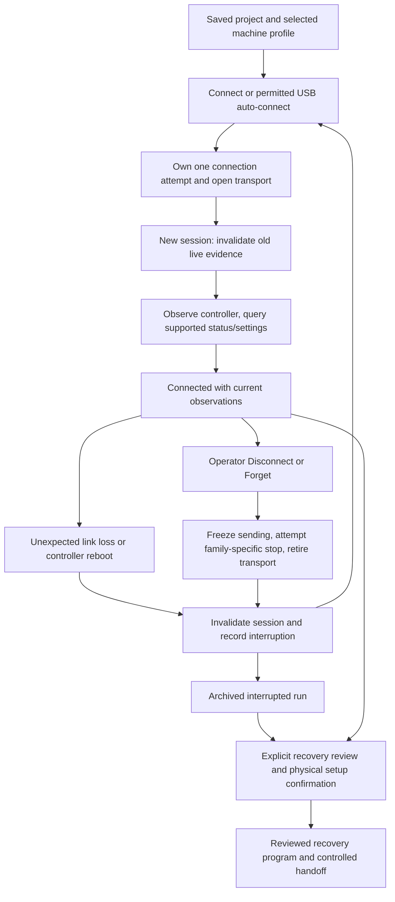

# Controller disconnect, reconnect, settings, and job recovery audit

Audit date: 16 October 2026. Baseline: `f7e2a36895b67cfa33be03c16e6c19e7c6722d14`, fetched from `origin/main`. The original repairs were developed on `codex/controller-reconnect-audit-20261016`; the selective integration and its separate evidence are recorded below.

## Verdict and scope

The architecture makes the right distinction between a saved project, a live controller session, and an archived interrupted run. Reconnection creates a new session, rereads available controller information, and does not automatically continue the previous job or write saved machine settings back to firmware. That contract should stay.

The baseline implementation was not fully correct. This audit found reproducible shutdown and command-ownership races, stale settings/position evidence, and an incorrect units comparison in CNC recovery. The accompanying changes repair these faults. This is source, automated-test, and simulator evidence; it does not qualify a physical machine, USB bridge, firmware build, laser output, or spindle stop.

Scope includes all five live controller kinds (GRBL 1.1, grblHAL, FluidNC, Marlin, and Smoothieware), vendor command-set differences including Falcon, main-thread and worker serial transport, Windows desktop transport, and desktop TCP. Ruida is included as a file-only controller: KerfDesk has no live Ruida connection or reconnect/resume protocol.

## The connection lifecycle

1. **Connection selection.** UI and menu commands derive driver, baud rate, command set, and streaming preference from the selected profile. A permitted remembered USB port may open without a chooser. Auto-connect runs at startup or a granted-port event, only when no connection, active job, motion, or controller operation exists. It never shows a chooser. TCP uses its explicit network connection flow.
2. **Attempt ownership.** A revision identifies the connection attempt. A cancelled chooser or late open cannot attach to the current store. An obsolete open is closed. Ordinary Disconnect retains permission; Forget also revokes it when the platform supports revocation.
3. **Session establishment.** The store clears old position, offsets, status, settings observations, controller identity/build observations, buffer-capacity evidence, overrides, and setup proofs. It increments session/evidence epochs so delayed callbacks cannot qualify a new machine.
4. **Qualification.** Connection is not itself proof of readiness. The handshake observes the controller, obtains status, and reads the supported settings/build/modal information. A controller without a unified settings dump uses its driver-specific qualification path. A failed read does not turn the saved profile into observed firmware settings.
5. **Explicit Disconnect.** One transaction owns stop and close; concurrent callers join it. Host job refill stops before transport waits. GRBL-family controllers use the existing owned reset/cleanup transaction. Marlin uses its queued stop commands; Smoothieware uses its halt/cleanup path when required. The transport then retires, subscriptions and timers are cancelled, and live evidence is cleared.
6. **Unexpected loss.** The app immediately retires the session and stops sending. It cannot send stop commands over an absent cable or socket. Already buffered controller motion may continue. An interrupted-run record is kept; the app does not label the job completed merely because it sent or received acknowledgements for all lines.
7. **Reconnect.** It opens and qualifies a new session. It does not restore old ACK ownership, queued job lines, a Frame permit, homing proof, probe result, or an automatic Resume. A recovery offer may appear; executing it remains an explicit operation.

Main source entry points: [connection actions](../../src/ui/state/laser-connection-actions.ts), [attempt ownership](../../src/ui/state/laser-connect-action.ts), [handshake](../../src/ui/state/laser-controller-handshake.ts), [teardown ownership](../../src/ui/state/laser-connection-teardown.ts), [auto-connect](../../src/ui/app/use-auto-connect-controller.ts), and [session reset](../../src/ui/state/laser-session-reset.ts).

## When reconnect is actually needed

- **A job is incomplete or normally paused:** this alone is not a reconnect condition. Preserve the current session and use its Pause/Resume workflow. Successful completion and ordinary Pause/Resume do not require another firmware-settings read.
- **The port still answers, but its settings read failed:** use the current-connection settings retry when no active job/command owns the controller. A failed read is not permission to restore the old snapshot or overwrite firmware settings from the profile.
- **The cable/socket was lost, opening failed, or command transport is unusable:** reconnect creates a replacement session after the underlying connection problem is addressed. A pending OS close can require a replug or app restart rather than repeated open attempts.
- **The board rebooted while the port stayed open:** invalidate the old evidence and requalify that session. A working port need not always be reopened, but the interrupted job must not resume automatically.
- **The controller reports an alarm, door hold, or halt:** handle that firmware condition explicitly. Reconnect is not a universal alarm reset. Homing, unlock, and physical board-reset requirements differ by firmware and by the cause of the stop.

The retry/reconnect distinction follows [ADR-212 Amendment 1](../decisions/ADR-212-amendment-1-existing-connection-recovery.md). It does not introduce a new Start policy gate.

## What is preserved, and what must be re-established

| State | Ordinary disconnect/reconnect | Reason |
| --- | --- | --- |
| Open project, artwork, operations, power/speed settings | Preserved | This is project state, not controller-session state. Unsaved work still needs the normal save/recovery mechanism across app termination. |
| Committed machine profile, calibration saved in that profile, tool/material libraries | Preserved | Disconnect is not machine deletion. The last committed profile is also restored at startup. |
| Browser/desktop permission and remembered USB choice | Preserved by Disconnect; revoked/forgotten by Forget where supported | This authorizes opening a port; it does not prove physical machine identity or position. |
| Firmware configuration stored by the board | Not erased or restored by reconnect | Persistence belongs to the firmware and its save mechanism. Reading a saved app profile must not overwrite another board. |
| Last live firmware-settings read | Invalidated and reread where supported | A different board, changed firmware, or failed write may have changed it. |
| Status, coordinate report, WCO, active WCS, accessory and override display | Invalidated; relearned from fresh reports | A cached number is not a current observation. This does not necessarily erase the corresponding board setting. |
| Homing proof, trusted physical position, probe/Work Z proof | Invalidated | Link continuity, power, stepper position, and workholding continuity are not established by reconnect. |
| Completed Frame and exact Start permit | Invalidated for the new session | The previous Frame belongs to previous machine evidence. Ordinary power/speed edits within an unchanged session retain spatial Frame evidence under ADR-565. |
| In-flight reply ledger and unsent job queue | Not replayed into the new session | Reusing them would attribute new replies to old commands or repeat uncertain cuts. |
| Archived interrupted job and progress checkpoint | Retained for explicit recovery | It records what the app knows, not the exact physical stop point. |
| Incident history | Retained across reconnect | It supports diagnosis after a new live transcript starts. Forget does not erase the historical incident log. |
| Unresolved physical-stop warning | Retained when stopping remains unconfirmed | Closing the app-side transport does not establish that output stopped. |

**Forget is stronger than Disconnect.** In addition to permission/port-memory cleanup, it clears the current controller/recovery/replay state. It preserves projects, committed profiles, libraries, preferences, and incident history; it is not a firmware factory reset. Use ordinary Disconnect when retaining the interrupted run is intended.

Profile persistence is implemented in [last-machine-persistence.ts](../../src/ui/state/last-machine-persistence.ts). Live clearing and Forget are in [laser-connection-actions.ts](../../src/ui/state/laser-connection-actions.ts) and [laser-store-helpers.ts](../../src/ui/state/laser-store-helpers.ts). Machine Setup detection populates an eligible draft; committing that draft is separate from a reconnect.

## Controller-family differences

| Controller | Status/settings and reconnect | Pause/stop and recovery implications |
| --- | --- | --- |
| GRBL 1.1 | `?` status, `$$` settings, supported build/modal/offset queries. Stored settings are firmware-owned. | Realtime safety-door/hold/resume and Ctrl-X reset have distinct meanings. Reset or power loss does not preserve host execution continuity. GRBL reports accepted commands before physical completion. |
| grblHAL | GRBL-family lifecycle with its driver-specific capabilities and settings. MPG takeover and coolant behavior are handled separately. | CNC/laser recovery still needs fresh session evidence. A configured door behavior may retain coolant; it must not be inferred from spindle-off alone. |
| FluidNC | GRBL-family status and read-only settings dump in KerfDesk; configuration remains managed by FluidNC's own tools/configuration. | Uses the owned GRBL-family reset/requalification path. Reconnect does not upload or restore a saved `config.yaml`. |
| Marlin | Queued `M114` status; no generic `$$` settings editor. Firmware options determine supported reporting and laser behavior. | No realtime pause in this driver. Pause stops future sending and queues output-off behind accepted work. Abort uses `M107`, `M410`, `M5 I`, and `M9` when required. These are transport-delivered commands, not proof of physical de-energization. |
| Smoothieware | Realtime status; no unified firmware-settings editor. Its reported MPos and WPos can provide a fresh work offset. | Ctrl-X is a halt, not a GRBL reboot. Generic `!`/`~` realtime pause is deliberately not advertised because transport/configuration prerequisites are not proved. Halt/unlock/requalification must follow the Smoothie path. |
| Ruida | File-only `.rd` output; no live transport in this app. | The controller owns transferred-job execution. KerfDesk cannot disconnect, reconnect, or resume that controller as a streamed job. |

The driver declarations are in [src/core/controllers](../../src/core/controllers). KerfDesk's CNC implementation is designed around GRBL-family capabilities. Unsupported-family findings are Job Review warnings under the existing policy, not new hard gates added by this audit. Laser recovery has GRBL-family, Smoothie, and Marlin inline/fan dialect handling.

**Marlin coordinate limitation:** standard `M114` exposes logical/work position. A G92 shift that existed before the app connected cannot be reconstructed by assuming the new logical frame is the physical machine frame. KerfDesk tracks G92 changes it observes or sends during the session; it does not recover an invisible old shift automatically. ADR-396 documents this limitation. Optional `M114 D` depends on firmware built with `M114_DETAIL`; this audit does not add an unqualified capability assumption.

## What should happen to a job

| Event | Correct continuation behavior |
| --- | --- |
| Normal Pause with the same live session | Resume may continue the held job after the driver's confirmation rules. Marlin/Smoothie stream-side behavior differs from GRBL-family realtime hold. |
| USB cable loss or TCP loss during a job | Stop host refill, record interruption, invalidate live proofs. Do not automatically Resume after reconnect. Buffered motion may have continued while the app was blind. |
| Board power loss or reboot | Treat execution and position continuity as lost. Establish the physical setup again before an explicitly reviewed recovery. |
| Operator Disconnect during a job | Attempt the appropriate stop, freeze host sending, then close. Keep the interrupted run for recovery unless Forget was requested. A write deadline does not prove the stop command reached the board. |
| Operator Abort | End the current job's sending; retain its stop cause for recovery. A later Connect is not an instruction to continue it. |
| App restart or crash | Restore saved application state and any durable recovery capsule. Do not restore a live stream or assume the controller's planner stopped with the app. |
| All program lines acknowledged, but no clean settlement yet | Still not a completed job. A disconnect here is an interruption. |

Recovery uses the archived executable artifact and its original profile/observations. It does not silently substitute the currently edited project. Progress is normally checkpointed every 25 acknowledgements; a crash or storage failure can leave a less recent durable record. The first terminal incident is retained so trailing acknowledgements do not rewrite the interruption point.

Laser recovery reconstructs the required modal/output state, travels with output off, and rearms at the reviewed burn sequence. It can retrace uncertain material and must not be described as exact physical-line continuation. CNC pass recovery uses a conservative restart boundary plus the operator's tool, workholding, XY/Z, and position confirmations. Advanced contour recovery has additional qualification requirements. A matching WCO only compares the coordinate offset; it does not prove the cutter, stock, or machine stayed physically in place.

Clean completion uses the driver's drain/settle sequence followed by fresh Idle evidence, with session and run ownership. An `ok` alone proves neither physical completion nor a stopped output. See [post-job settlement](../../src/ui/state/laser-post-job-settle.ts), [checkpoint capture](../../src/ui/app/use-job-checkpoint.ts), [CNC pass recovery](../../src/ui/laser/cnc-pass-recovery-flow.ts), and [laser recovery](../../src/ui/laser/laser-recovery-flow.ts).

## Confirmed faults repaired

| Finding | Baseline failure | Repair and regression evidence |
| --- | --- | --- |
| Cancelled connection stayed in Connecting | Disconnect during a pending chooser/open left the UI owned by a cancelled attempt; a late grant lookup could still open the chooser. | Retire the public connecting state immediately and fence chooser continuation. Twelve new cases cover all five live kinds and superseded attempts. |
| Serial shutdown could wait forever | The previous writer timeout then awaited `abort()`, which itself waits behind an in-flight sink operation. Reader cancellation and native port close were also unbounded. | Bound host waiting, consume late failures, retain unresolved native-close ownership, and refuse reopening that same still-closing port. Tests use real Streams as well as transport fixtures. |
| Closing transport accepted new work or delivered stale lines | Main-thread writes could still be admitted during close; a second close could finish before cleanup; close-subscriber exceptions could interrupt serial/TCP cleanup; queued worker/chunk lines could arrive after retirement. | Immediate admission fence, shared close promise, isolated close notifications, and late-line suppression. |
| Marlin/Smoothie Disconnect could refill a live job | An `ok` arriving while the first stop write waited sent another `G1` job line. A stalled stop write could prevent close indefinitely. | Freeze host work and cancel pending command owners before the first wait, preserve reply debt, and bound each stop-write attempt. Four baseline cases reproduced both failures across these families. |
| Marlin Abort could refill while stopping | The no-reset stop path left the streamer active until all stop writes completed. | Retire unsent job work before the first queued stop await, retain in-flight ACK debt and stop cause. A regression reproduced an extra `G1 X2 S100` during Abort. |
| Disconnect could lose command ownership | Pause/Resume admission and reset/alarm handlers could admit or restore commands while a port was being retired. | Use the durable connection-close claim as well as the public operation, and preserve the disconnect operation through fault boundaries. |
| Firmware-setting writes retained obsolete proof | Machine Settings and Console could show old settings, Home/Z/Frame evidence, or qualified settings while a positional write was pending or had an uncertain outcome. | Invalidate before dispatch; classify spatial versus process-only settings using the driver; reread actual values; leave failed/empty readback unqualified. Process-only edits preserve the unchanged spatial Frame. |
| Position suppression leaked into the next connection | A deliberate old-session suppression flag survived explicit disconnect/reconnect and prevented the replacement controller's position from being usable. | Clear the suppression at new-session establishment; keep old Home/Z/Frame proofs invalid. |
| CNC retained-origin comparison mixed inches and millimetres | Equal raw numbers could falsely match different physical offsets; equivalent physical offsets could falsely mismatch. | Normalize archived and live WCO to millimetres, require known reporting units, and recheck at the final recovery handoff. Unconfirmed units require the explicit re-zeroed route. |
| Recovery wording overstated ACK evidence | The late-pass warning said acknowledgements proved execution through a pass. | Describe the conservative ACK/buffer estimate and retain physical verification. |

The transport and state regressions exercise delayed completions, failed writes, late acknowledgements, concurrent cleanup, replacement sessions, and firmware fault boundaries. They are not just snapshots of the implementation.

## Remaining limits and operator implications

- **USB adapter identity is not unique machine identity.** Renderer port memory stores VID/PID. It asks when several matching granted ports are present, but a single other previously granted adapter of the same model can match. Windows device permission is more specific than this renderer selection. On a multi-machine installation, choose the intended port explicitly or disable automatic connection when that distinction matters. Reconnect cannot certify that the original physical machine is attached.
- **A rapid replug may require manual Connect.** Auto-connect is event-driven and skips events while busy; it does not queue every skipped plug event for later retry. It also does not resume jobs.
- **A host close deadline is not OS release.** The repaired transport bounds the caller's wait and rejects a timeout, while retaining actual cleanup ownership. Unresolved stream cleanup or native close may still need a replug or app restart. The same closing port is refused until ownership is released.
- **Firmware may act on connection/reset.** Some boards reset when serial control signals change. Firmware startup blocks, external pendants, SD jobs, and board configuration can cause behavior outside the host's read-only handshake. No claim of motionless physical reconnect can be made for every arbitrary firmware configuration.
- **Saved firmware settings have firmware-specific persistence.** GRBL settings are stored in EEPROM; Marlin's current settings report and saved EEPROM settings are distinct (`M503` versus `M500`); FluidNC and Smoothie have their own configuration mechanisms. Disconnect must not silently issue factory-reset, restore-default, or save-configuration commands.
- **Hardware qualification remains outstanding.** No real cable was pulled, no board was power-cycled, and no laser/spindle/motion was operated. Qualification must distinguish idle disconnect, buffered-job loss, lost power, board reset, app exit/crash, and repeated reconnect on each actual machine/firmware/transport combination. A physical stop/output check and re-establishment of position cannot be replaced by passing software tests.

## Author snapshot verification record

The results below belong to the original reconnect snapshot on base `f7e2a36895b67cfa33be03c16e6c19e7c6722d14`. They are not new validation of the integrated source.

- **Controller integration:** 1,585 tests passed across 152 files. This selection covers all controller drivers, main-thread/worker serial transport, desktop network adapters, connection ownership, settings, Pause/Resume/Abort, checkpoint storage, machine-profile persistence, and CNC recovery. The local result is `artifacts/controller-reconnect-integration.json`; the selected files are recorded in `artifacts/controller-reconnect-integration-selection.json`. This was a focused integration run, not the entire repository's release suite.
- **Final regression follow-up:** all 11 Disconnect/Pause/Resume ownership tests passed again after correcting a circular type inference in the test fixture's cleanup registry. After extracting helpers to meet the lint size limits and normalising a rejected write into an `Error`, all 59 affected tests across nine files passed. The latter result is `artifacts/controller-reconnect-final-followup.json`.
- **Native TCP transport:** four loopback integration tests passed. These exercised local sockets, not a connected machine.
- **Desktop-renderer browser checks:** five selected scenarios passed in real Chrome with simulated Web Serial: incident retention through reconnect; committed machine settings across New and renderer restart; a paused-then-disconnected job's recovery; automatic recovery review with explicit home/origin restoration; and exclusive recovery ownership across two windows. This browser evidence uses the GRBL fixture; other firmware families are covered by source/driver/transport/state tests. These browser runs preceded the final helper extraction; the focused follow-up above covers those final edits.
- **Formatting and size:** changed TypeScript files passed Prettier; the repository file-size policy passed, and final changed-file raw limits and `git diff --check` passed.
- **Static verification:** changed-file ESLint passed, including the extracted helpers and fixtures. A full TypeScript check passed after fixing the circular fixture types, and the final incremental TypeScript check passed after the subsequent extraction. Both used the repository's strict configuration with `--noEmit`; the incremental pass kept its build metadata in the ignored `artifacts` directory.

The first browser attempts hit development-server setup timeouts before the persistence/recovery assertions ran. Traces showed an approximately 80-second navigation and individual lazy module responses over ten seconds, without a page error. The final three scenarios used an ignored local Playwright configuration with a 300-second overall allowance and 60-second assertion allowance; the scenario assertions and application source were unchanged for these reruns. Browser artifacts are under the task's `controller-reconnect-browser` visualization directory. These results do not establish packaged desktop startup performance.

No physical controller, motion, laser, spindle, material, or installed-package qualification was performed. No release, merge, or publication was performed.

## Selective integration with controller pipeline and network connections

The integration starts from `326e2c7fcbfbaf2c432de8e47faf8e20807f227b`, combining controller pipeline `79b4ce0076884e1b670178ed097d16fe5639fa07` and the reviewed network changes. It retains ADR-600's serial ownership implementation: registration precedes stream cleanup, caller timeout rejects without releasing the actual owner, Forget waits for successful cleanup, and worker stream-release polling uses bounded progressive backoff. The reconnect snapshot's weaker native-close-only registry and writer-close implementation are not imported. Its close tests are adapted to assert the stronger truthful failure and retained-ownership contract.

The integration also retains the pipeline's synchronous Marlin Abort retirement, terminal reply ownership and stop-command snapshot. It adds disconnect-operation preservation, late-line suppression and subscriber containment. TCP protocol selection and reconnect intent remain intact while adding the cancelled-attempt chooser fence. Settings, recovery units and pause/resume ownership fixes are imported independently.

Integrated verification: 158 tests passed across 20 files, including all changed reconnect suites and the preserved bounded-close, progressive-backoff and Marlin reply-ownership suites. Receipts are `output/reconnect-integration/vitest.json`, `vitest.log` and `test-selection.json` in the integration checkout. Changed-source ESLint passed. A further 18 tests across three connection-routing/Forget suites passed (`routing.json` and `routing.log`), including TCP retry without USB fallback. Final changed-source Prettier, repository file-size policy and `git diff --check` passed. The full strict renderer TypeScript check and production desktop renderer build also passed. The controller ancestor now includes its real-worker timeout regression correction, which requires retained locked-stream ownership rather than pretending close succeeded; its seven browser scenarios and e2e static checks passed separately. These are new combined-source checks; the historical author results above do not qualify this combined source. No hardware or installed-package qualification is claimed.

The controller follow-up also keeps an actual Forget operation alive after its caller-facing timeout. Permission revocation waits for successful actual cleanup, occurs once, and retains port ownership until revocation settles. A failed stream/native cleanup never revokes permission. Five regressions reproduced the missing late revocation before repair. The repaired controller source passed 80 focused tests and a full strict TypeScript check. After combining it here, 39 transport tests and 22 controller state/Forget tests passed, along with the full strict incremental TypeScript graph and scoped lint/format checks. These selections overlap earlier evidence and are not an aggregate suite total.

## Primary protocol sources

- [GRBL 1.1 interface](https://github.com/gnea/grbl/wiki/Grbl-v1.1-Interface): acknowledgement semantics and coordinate report units.
- [GRBL 1.1 commands](https://github.com/gnea/grbl/wiki/Grbl-v1.1-Commands) and [configuration](https://github.com/gnea/grbl/wiki/Grbl-v1.1-Configuration): reset, persistent settings, startup blocks, and coordinate-state distinctions.
- [Web Streams specification](https://streams.spec.whatwg.org/#writable-stream-finish-erroring) and [Web Serial close](https://serial.spec.whatwg.org/#dom-serialport-close): asynchronous stream/port ownership during close.
- [Marlin M114](https://marlinfw.org/docs/gcode/M114.html), [M503](https://marlinfw.org/docs/gcode/M503.html), and [M500](https://marlinfw.org/docs/gcode/M500.html): reporting and persistence differences.
- [Marlin 2.1.2.8 position implementation](https://github.com/MarlinFirmware/Marlin/blob/2.1.2.8/Marlin/src/module/motion.cpp#L151-L227): logical positions and workspace shifts.
- [Smoothieware console commands](https://smoothieware.org/console-commands) and [configuration](https://smoothieware.org/configuration-options): controller-specific commands and configuration.
- [FluidNC repository and configuration documentation](https://github.com/bdring/FluidNC): firmware configuration ownership.
